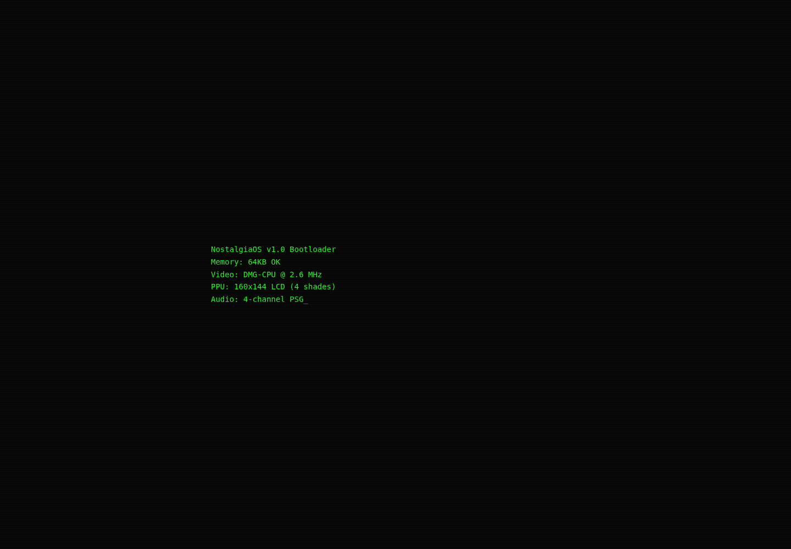

# NostalgiaOS



Ретро-десктоп в браузере: загрузочный экран в стиле CRT, сканирующие линии,
иконки игр и локальный профиль игрока.

## Что внутри

- Boot-сцена с посимвольным выводом и прогресс-баром.
- Ретро-десктоп с CRT-эффектами и taskbar.
- **Snake** и **Minesweeper**.
- Профиль игрока: запуски, наигранное время, рекорды, Memory Points.
- Достижения и localStorage-персистентность.
- Атмосфера старых портативных консолей: зелёная монохромная палитра, scanlines, glow.

## Стек

- React 19 + Vite
- Tailwind CSS 4
- localStorage
- Canvas/Grid-механики для игр

## Запуск

```bash
npm install
npm run dev
```

Сборка:

```bash
npm run build
npm run preview
```

## Статус

Прототип. Сейчас чиню boot-сценарий: после загрузки на некоторых сборках
десктоп не успевает инициализироваться. Игры и профиль уже написаны.
